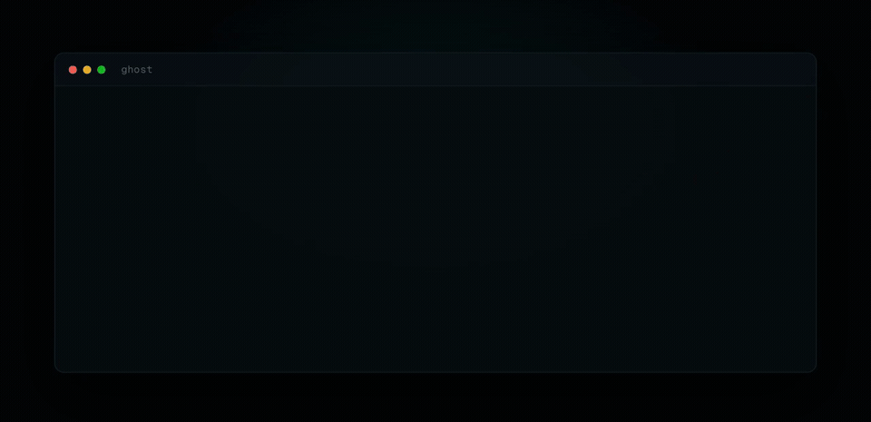

# ghost 👻

[](LICENSE) &nbsp; &nbsp;[](https://github.com/NousResearch/hermes-agent) &nbsp;

**A private, unrestricted agentic harness.** A real terminal agent that runs commands, edits files, executes code, and searches the web, with every hosted request sealed to OpenGradient's TEE gateway so that nobody on the way can tie what you asked to who you are. It answers what you actually ask, drops to a local model on demand, and phones home to no one.

Built on the [Hermes Agent](https://github.com/NousResearch/hermes-agent) engine by Nous Research, wired to OpenGradient's gateway and to only open-weight, unrestricted models.

<p align="center">
  
</p>

## Install

One command, about two minutes and 2.5 GB of disk. The only prerequisite is `git`: ghost brings its own Python, Node and engine, and keeps all of it in `~/.ghost` and `~/.ghost-engine`. Outside those there is only its command in `~/.local/bin` (and a line in your shell's startup file if it didn't look there).

**macOS, Linux, WSL2:**

```bash
curl -fsSL https://raw.githubusercontent.com/OpenGradient/ghost/main/install.sh | bash
```

**Windows (PowerShell, no administrator needed; on ARM, use WSL2):**

```powershell
irm https://raw.githubusercontent.com/OpenGradient/ghost/main/install.ps1 | iex
```

Then:

```bash
ghost
```

The first run asks how you want to log in. Nothing is contacted before that.

| | |
|---|---|
| **DreamFort account** | Your plan and credits. Sign in on [dreamfort.ai](https://www.dreamfort.ai) and ghost picks it up; over SSH, paste what the page shows. |
| **DreamFort API key** | Billed by usage. Create one at [api.dreamfort.ai](https://api.dreamfort.ai/api-keys) and paste it. |

`ghost login` switches between them. In a script or a container: `cat keyfile | ghost-login --with-api-key`.

## Everyday commands

| | |
|---|---|
| `ghost` | Start chatting. `ghost -c` continues your last chat. |
| `ghost -z "question"` | Ask once and print the answer. A long question can come from a file: `ghost chat --query-file FILE` (`-` for stdin). |
| `ghost --local` | Use the offline model: what you type stays on this machine, and the web tools are off. |
| `ghost doctor` | Check that everything works, and what to do if it doesn't. |
| `ghost usage` / `ghost budget` | What hosted models have cost you, what credits are left, and the hourly limit. |
| `ghost login` / `ghost logout` | Change how you're connected. |
| `ghost update` | Get the latest release, with the options you installed with. |
| `ghost uninstall` | Remove ghost. Your chats, settings and login stay unless you add `--purge`. |

Inside a chat, `/model` switches models, `/goal <objective>` sets a standing goal, `/help` lists the rest.

<details>
<summary>Install options</summary>

Set these as environment variables on the install command (`curl ... | GHOST_LOCAL=1 bash`). `ghost update` remembers them; `=0` switches one off again.

| | |
|---|---|
| `GHOST_LOCAL=1` | Also install Ollama and an offline model (6GB), which becomes the fallback. `GHOST_LOCAL_32B=1` adds the stronger 32B (26GB). |
| `GHOST_NO_BROWSER=1` | Skip Chromium and the computer-use driver: a smaller (1 GB), faster install. |
| `GHOST_VERBOSE=1` | Show everything the installer runs. Otherwise it's in `~/.ghost/install.log`. |

On Windows, from a clone: `powershell -ExecutionPolicy Bypass -File .\install.ps1 -Local -NoBrowser`.

An update keeps the settings you changed in `~/.ghost/profiles/uncensored/config.yaml`, and a `SOUL.md` of your own (the release's is then beside it, as `SOUL.md.new`).

**On a company network**, ghost uses the system's proxy (or `HTTPS_PROXY`) and the certificates the system trusts. It needs to reach `chat-api.memchat.io`, and `ogevmdevnet.opengradient.ai`, where it reads which enclaves to trust. If the network inspects TLS, exempt the second one: ghost won't take that from an intercepted connection, and falls back to an enclave built into the release. Installing also needs `github.com`, `*.githubusercontent.com`, `astral.sh`, `*.astral.sh`, `pypi.org`, `files.pythonhosted.org`, `nodejs.org`, `registry.npmjs.org` and, for the browser, `cdn.playwright.dev` and `storage.googleapis.com`.

</details>

## Why ghost exists

### Problem #1: The Model Lectures You Instead of Working

> "The Net interprets censorship as damage and routes around it."
>
> John Gilmore, [EFF cofounder](https://en.wikipedia.org/wiki/John_Gilmore_(activist))

**The Problem.** Frontier models refuse, moralize, and water answers down. You ask something direct, security research, something adult, something dual-use, something merely uncomfortable, and you get a disclaimer and a redirect to "safer alternatives."

**The Fix.** ghost only connects **open-weight, unrestricted models** (Abliterated Large v2 by default, with its refusals removed from the weights; plus DeepSeek V4 Pro and Hermes 4 405B, steered), so the default answers in full with no sermon. Closed, refusing models (Claude, GPT, Gemini, Grok) aren't offered, and the gateway rejects anything off the list. It treats you as a competent adult, but it isn't an edgelord either: it won't volunteer illegal or shock content, it just won't refuse you.

### Problem #2: The Provider Knows It's You

> "Privacy is the power to selectively reveal oneself to the world."
>
> Eric Hughes, [A Cypherpunk's Manifesto](https://www.activism.net/cypherpunk/manifesto.html)

**The Problem.** "Hosted inference" means your prompts, your code, whatever you're working on, land on someone else's servers with your name on them: one company holds both who you are and everything you asked.

**The Fix.** Every hosted request is sealed on your machine (HPKE/OHTTP, with [opengradient-ohttp](https://github.com/OpenGradient/sdk/tree/main/packages/opengradient-ohttp)) and opened only inside an attested **TEE enclave**. The relay that knows your account sees ciphertext. The enclave that opens the prompt never learns whose it is, and passes it to the model's host under its own key with nothing of yours attached. Its signature is checked before a single token reaches you. [Who sees what](#how-the-private-path-works), exactly. Need zero egress? `ghost --local` runs a model on your own machine, with the web tools off.

> [!TIP]
> And it doesn't give up. Most agents stop and ask after the first error; ghost reads the actual error, installs what's missing, changes tactics, and keeps going until the task is done. Set a standing goal with `/goal <objective>` and it works toward it across turns on its own.

## ghost vs the alternatives

|  | ghost | a vanilla coding agent | a hosted chat app |
|---|:---:|:---:|:---:|
| Someone can tie your prompts to you | **No** -- TEE + OHTTP | Yes | Yes |
| Refuses / moralizes | **No** -- open-weight + steer | Often | Often |
| Runs fully offline | **Yes** -- `--local` | No | No |
| Real terminal + tools | **Yes** | Yes | No |
| Open-weight models | **Only** | Rarely | Rarely |
| Install needs an LLM | **No** -- one `curl` | Sometimes | n/a |

## The model line-up

Switch with `/model`, all open-weight, nothing closed or refusing:

| Model | What it is |
|---|---|
| `abliteration/abliterated-model-large-v2` **(default)** | Uncensored by abliteration, with refusals removed from the weights rather than steered past. 1M context; built for authorized offensive-security, red-team and long-horizon agent work. |
| `deepseek/deepseek-v4-pro` | Strongest open reasoning + coding model; uncensored via ghost's steer. |
| `abliteration/deepseek-v4.1-flash-abliterated` | Fast and far cheaper ($0.41 / $1.62 per million tokens in / out, against the default's $4.05 / $6.75), reads images, 1M context, and the one whose host runs in TEEs too. Runs ghost's auxiliary tasks (titles, compression, etc.). |
| `nous/hermes-4-405b` | Flagship uncensored open model, the most steerable. |
| local (opt-in) | Abliterated 7B / 32B via `GHOST_LOCAL`, fully offline, zero egress. |

## How the private path works

```
ghost engine
  └─ bridge (127.0.0.1:8788)   limits and budget, seals the request to an attested enclave
       └─ relay (chat-api)       your login and IP, but only ciphertext
            └─ TEE enclave       opens it, calls the model, signs the reply (the bridge checks it)
                 └─ model's host   the prompt, under the gateway's key
```

| | Sees who you are (account, IP) | Sees what you wrote |
|---|:---:|:---:|
| DreamFort's relay | Yes | **No**, only ciphertext |
| The enclave | **No** | Yes, inside attested hardware |
| The model's host | **No** | Yes |

The model's host is NEAR AI for DeepSeek V4.1 Flash Abliterated (served from TEEs as well), abliteration.ai for Abliterated Large v2, Together for DeepSeek V4 Pro, and the cheapest host on OpenRouter for Hermes 4 405B. They get the text and nothing else: no account, no IP, no header of yours, and ghost leaves your user name out of what it tells the model about your machine. What's *in* the text is still in the text: a prompt that names you names you, and so does a file or a command's output that the agent reads for you. When that isn't good enough, `ghost --local` sends it nowhere.

The agent's own web searches, page fetches and browser go out from your machine like any browser's, not through the enclave. Searches ask DuckDuckGo, then Brave, Startpage, Mojeek, Yahoo and Google until one answers.

## Honest limits

- **Hosted models cost credits.** `ghost usage` shows what you've spent, and ghost pauses itself after $5 in an hour so nothing runs away with your balance; change that with `ghost budget 20` or `ghost budget off`. What comes back unusable is reported, not paid for again: at most one retry, when the connection broke.
- **Chats don't stay.** A chat is deleted a day after it ends, along with what you typed. To keep them, set `sessions.auto_prune: false` in `~/.ghost/profiles/uncensored/config.yaml`.
- **Your keys stay yours.** Keys for other vendors in your environment (OpenAI, OpenRouter, ...) are kept from the engine, so nothing goes to them by surprise. Put one in `~/.ghost/profiles/uncensored/.env` to use it on purpose.
- **Replies arrive whole.** The signature covers the complete reply, so ghost shows it once it's verified rather than word by word.
- **The local model is opt-in and weaker.** Off by default (`GHOST_LOCAL`); it's a much smaller model, and it shows in long agentic work.
- **It asks before it deletes.** Commands that delete folders, overwrite system files and the like wait for your OK; `--yolo` turns that off.
- **The engine is forked, not rewritten.** It's one pinned Hermes release ([`engine.pin`](engine.pin)), patched and self-contained: no separate Hermes install is needed or touched, and `ghost update` is what moves it. Internal package names stay `hermes_cli`.
- **Two small background processes.** The bridge is a service (launchd, systemd or Task Scheduler) that starts with your machine. Your sessions run in a local gateway that ghost starts when you do and that exits after 10 idle minutes (unless you install it as a service with `ghost gateway install`).

## License

[MIT](LICENSE). The Hermes Agent engine it builds on is under its own license.

## Security

ghost is a privacy tool; anything that ties your prompts to you, or lets them out unsealed, is treated as a P0. See [SECURITY.md](SECURITY.md) for how to report one privately.
